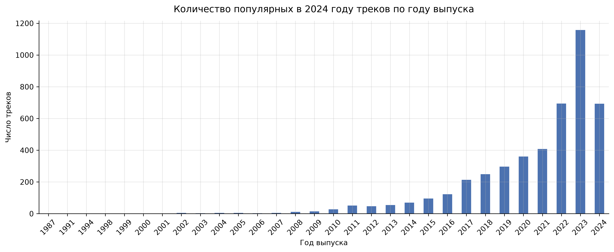
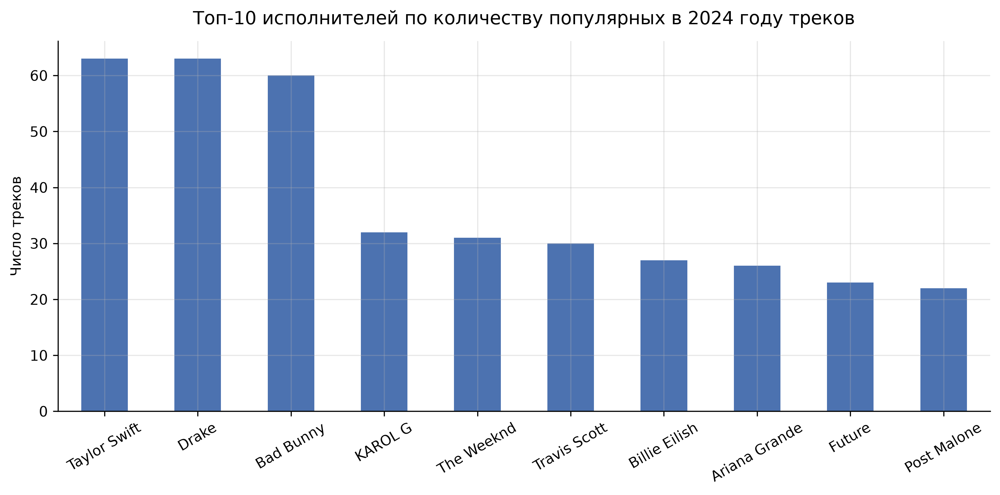
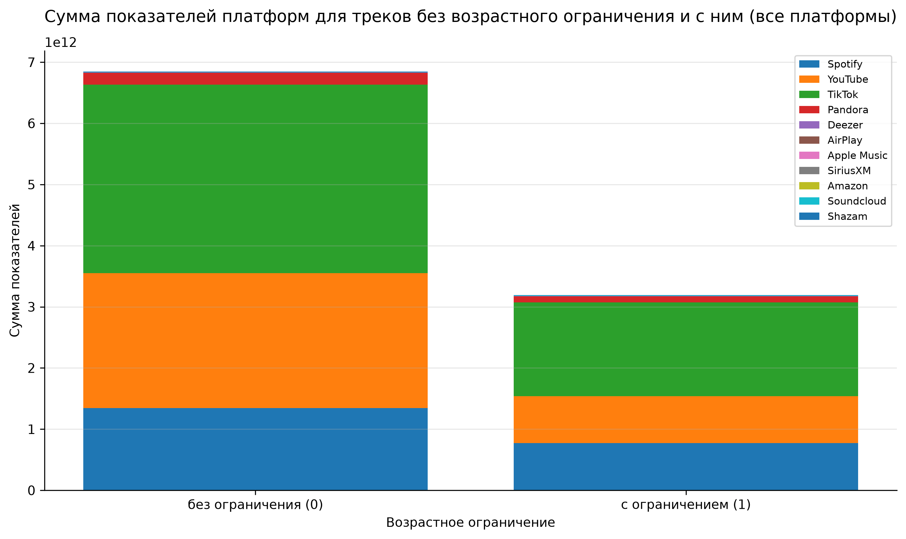

# Анализ самых прослушиваемых треков Spotify в 2024 году


exploratory data analysis (EDA) датасета [Most Streamed Spotify Songs 2024](https://www.kaggle.com/datasets/nelgiriyewithana/most-streamed-spotify-songs-2024): **4 600 треков × 29 показателей** — стримы, лайки, добавления в плейлисты и просмотры по 11 платформам (Spotify, YouTube, TikTok, Apple Music, Deezer, Pandora, Soundcloud и др.).

Проект оформлен как воспроизводимый Python-пакет: логика анализа отделена от нарратива, покрыта тестами и запускается одной командой.

**English summary:** end-to-end exploratory analysis of the Most Streamed Spotify Songs 2024 dataset (4,600 tracks × 29 metrics across 11 platforms), packaged as a reproducible Python project with a CLI pipeline, tests, linting and CI. See [Overview (English)](#overview-english).

---

## Постановка задачи

**Легенда.** Заказчик — сайт для скачивания музыки. Цель — определить, какие исполнители, треки и альбомы наиболее востребованы у аудитории на разных платформах, чтобы добавить их в базу сайта и использовать в таргетированной рекламе.

**Задачи анализа:**

1. найти 10 самых популярных треков по общим показателям (*All Time Rank*, *Track Score*) без возрастного ограничения;
2. собрать удобную таблицу: трек — альбом — исполнитель — дата релиза — ISRC;
3. оценить, как год выпуска влияет на популярность в 2024 году;
4. найти исполнителей с наибольшим числом популярных треков;
5. вычислить описательные статистики *Track Score* по этим исполнителям;
6. проверить, влияет ли возрастное ограничение (explicit) на популярность на разных платформах.

## Ключевые результаты

| Вопрос | Ответ |
| --- | --- |
| Топ-10 треков (без explicit) | Совпадает по *All Time Rank* и *Track Score*: «MILLION DOLLAR BABY», «i like the way you kiss me», «Flowers», «Beautiful Things», «LUNCH» и др. |
| Влияние года выпуска | Популярность экспоненциально падает с возрастом релиза; более половины хитов 2024 года выпущено в 2022–2024 |
| Лидеры по числу хитов | Taylor Swift и Drake (по 63 трека), Bad Bunny (60) |
| Качество vs стабильность | У Billie Eilish — самый высокий средний и медианный *Track Score* (82.3 / 54.7) при большом разбросе; у Drake — самый стабильный рейтинг |
| Влияние explicit-флага | На большинстве платформ суммарно доминируют треки без ограничения; исключения — SiriusXM и Soundcloud |
| Лидеры платформ | «Blinding Lights» — 4,28 млрд стримов Spotify; «Baby Shark» — 16,3 млрд просмотров YouTube; «Laxed (Siren Beat)» — 42,9 млн постов TikTok |







Полный нарратив с таблицами и промежуточными выводами — в ноутбуке
[notebooks/spotify_2024_analysis.ipynb](notebooks/spotify_2024_analysis.ipynb).

## Пайплайн

```
data/raw/*.csv ──► load + clean ──► analysis (таблицы) ──► reports/tables/*.xlsx
                        │                    │
                        └──► plots ──────────┴──► reports/figures/*.png
```

* **`spotify_analysis.data`** — загрузка CSV (файл Kaggle содержит битую кодировку, читается в `latin-1`) и очистка: удаление пустой колонки `TIDAL Popularity`, даты → `datetime`, текст → `string`, метрики со строковыми разделителями тысяч → `int64`, пропуски в метриках → 0.
* **`spotify_analysis.analysis`** — аналитические таблицы: совмещённый топ треков (с проверкой, что ранжирования по *All Time Rank* и *Track Score* совпадают), статистики исполнителей, лидеры платформ (для Soundcloud лидер ищется только среди треков без explicit — бизнес-правило заказчика), группировки для диаграмм.
* **`spotify_analysis.plots`** — диаграммы в едином стиле; функции возвращают `fig/ax`, сохранение — на стороне вызывающего кода.
* **`spotify_analysis.pipeline`** — CLI (`spotify-analysis` или `python -m spotify_analysis`), который пересобирает все таблицы и диаграммы.

Весь код обращается к колонкам по именам из `spotify_analysis.config` — анализ не сломается при изменении порядка колонок в CSV.

## Структура репозитория

```
├── data/
│   └── raw/                        # исходный CSV с Kaggle
├── notebooks/
│   └── spotify_2024_analysis.ipynb # аналитический нарратив (выполнен, с выводами)
├── src/spotify_analysis/
│   ├── config.py                   # пути, имена колонок, бизнес-правила
│   ├── data.py                     # загрузка и очистка
│   ├── analysis.py                 # аналитические таблицы
│   ├── plots.py                    # диаграммы
│   ├── pipeline.py                 # CLI-пайплайн отчётов
│   └── __main__.py
├── tests/                          # pytest: очистка, таблицы, интеграционный тест
├── reports/
│   ├── figures/                    # диаграммы (png, 300 dpi)
│   └── tables/                     # итоговые таблицы (xlsx)
├── Makefile
└── pyproject.toml
```

## Быстрый старт

Требуется Python 3.10+. Удобнее всего через [uv](https://docs.astral.sh/uv/):

```bash
make install          # venv + зависимости + пакет в editable-режиме
make run              # пайплайн: пересобирает reports/tables и reports/figures
make notebook         # пересобрать ноутбук (jupyter lab)
make test             # тесты
make lint             # ruff check + format --check
```

Без make:

```bash
pip install -e ".[dev]"
spotify-analysis                 # или: python -m spotify_analysis
pytest
```

CLI принимает параметры: `spotify-analysis --input path/to.csv --reports-dir reports`.

## Качество кода

* **Тесты** (pytest, 18 шт.): очистка данных на синтетическом датасете (разделители тысяч, пропуски, типы), корректность аналитических таблиц (фильтрация explicit, бизнес-правило Soundcloud, ручные исправления лидеров), интеграционный прогон пайплайна на реальных данных.
* **Линтеры**: ruff (check + format), настроены в `pyproject.toml`.
* **CI**: GitHub Actions — линтер и тесты на Python 3.10–3.12 при каждом push и PR (`.github/workflows/ci.yml`).

## Известные ограничения данных

* Файл Kaggle содержит необратимо повреждённые многобайтовые символы (битая кодировка): часть названий треков и альбомов читается с артефактами. Два самых заметных случая (Track у «Laxed (Siren Beat)», Album у «Baby Shark») исправлены в таблице лидеров через конфигурацию; ISRC остаётся источником истины.
* Пропуски в метриках платформ трактованы как нули (отсутствие трека на платформе), что подходит для суммарных сравнений, но занижает показатели редко представленных платформ (например, у Soundcloud нет данных для ~72 % треков).

## Overview (English)

Exploratory analysis of the [Most Streamed Spotify Songs 2024](https://www.kaggle.com/datasets/nelgiriyewithana/most-streamed-spotify-songs-2024) dataset (4,600 tracks × 29 metrics across 11 platforms), built as a portfolio-grade, reproducible Python package:

* **Pipeline CLI** (`spotify-analysis`): raw CSV → cleaning (broken encoding, thousand separators, dtypes, missing values) → analytical tables (top tracks, artist score statistics, per-platform leaderboards, explicit vs clean totals) → Excel tables + PNG charts in `reports/`.
* **Business framing**: find tracks without age restriction for a music-download site; the Soundcloud leaderboard therefore considers clean tracks only.
* **Key findings**: top-10 clean tracks coincide by All Time Rank and Track Score; hit probability decays near-exponentially with release age; Taylor Swift and Drake lead by hit count; explicit tracks dominate only on SiriusXM and Soundcloud.
* **Engineering**: column-name-driven config, pytest suite (18 tests incl. an end-to-end run on real data), ruff lint/format, GitHub Actions CI.

## Технологии

Python 3.10+ · pandas · NumPy · Matplotlib · openpyxl · Jupyter · pytest · ruff · Make · GitHub Actions
